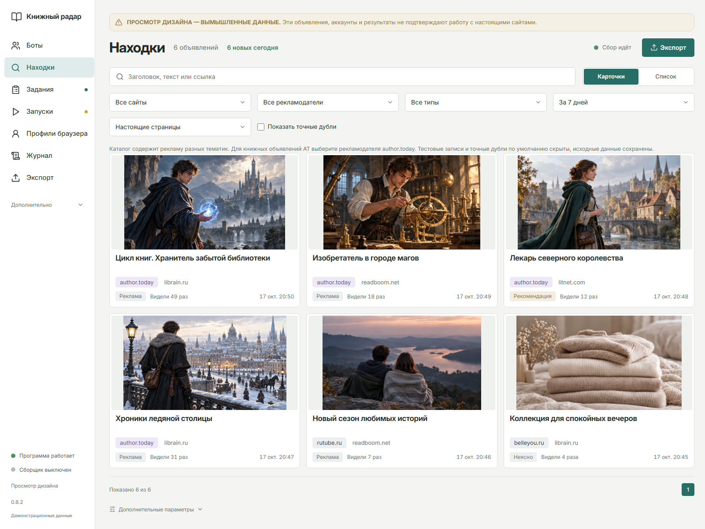
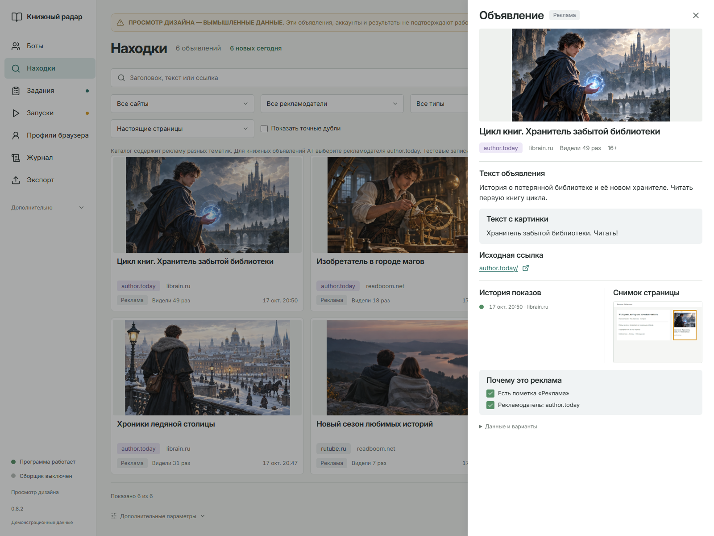
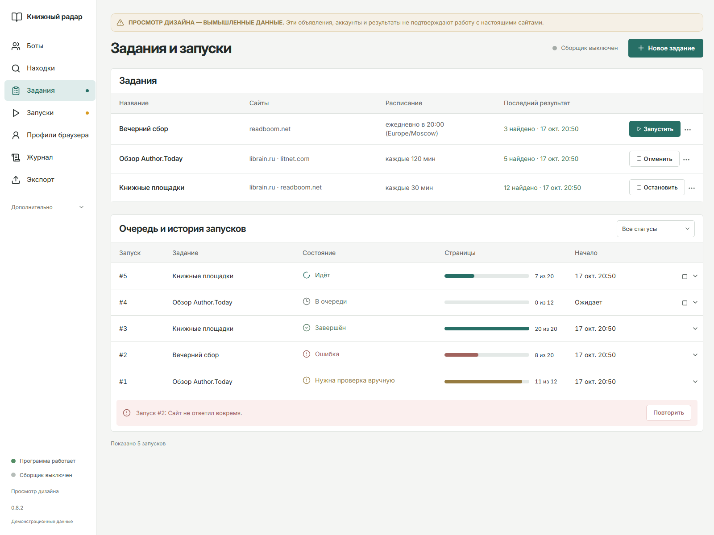
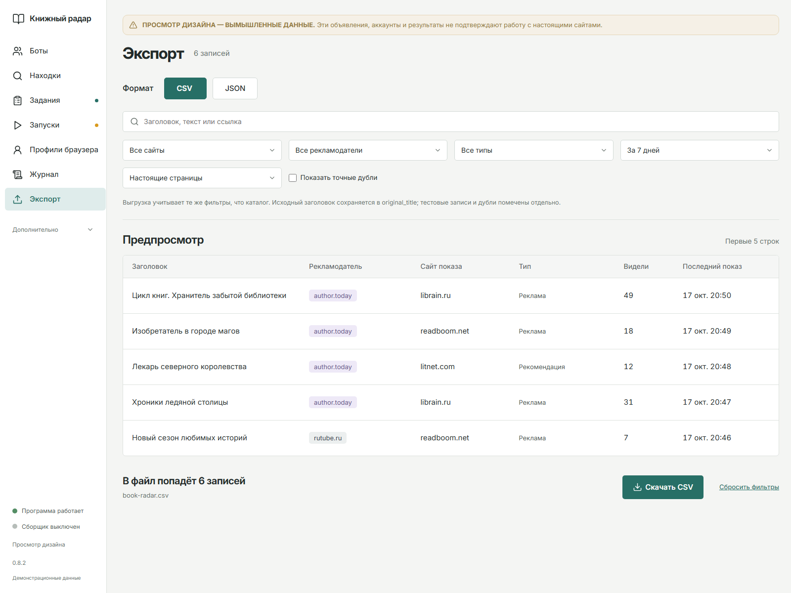
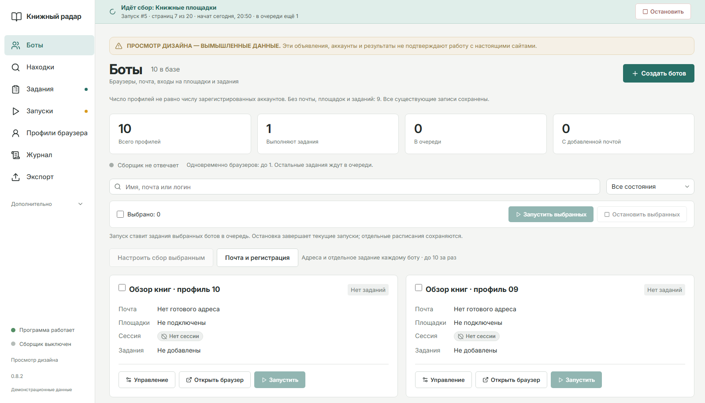
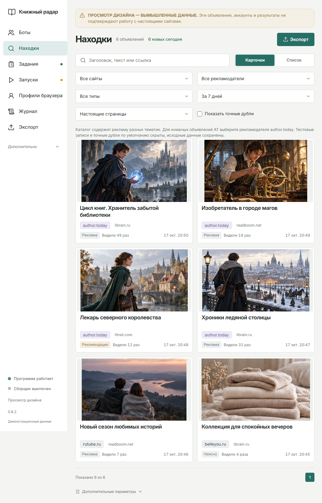
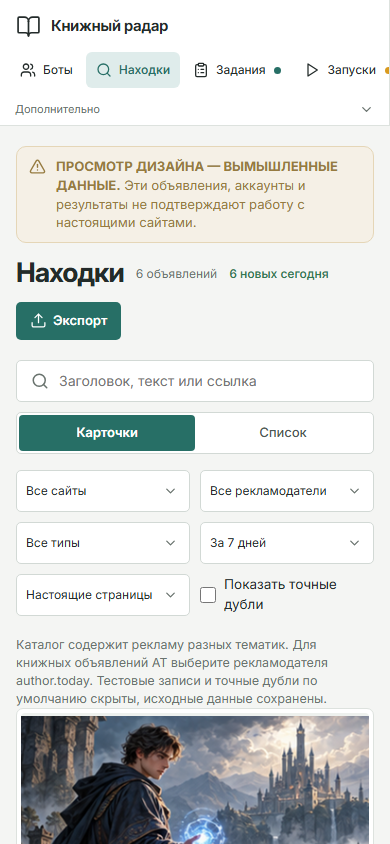
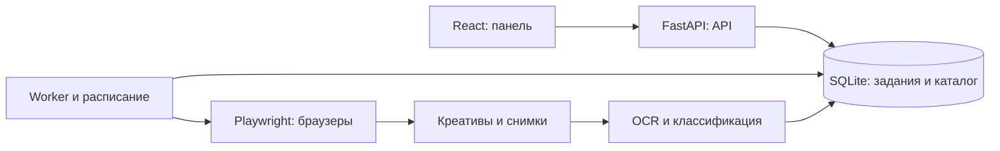

<div align="center">

# Книжный радар

**Веб-панель для мониторинга и анализа книжной рекламы**

`Python` · `FastAPI` · `React 19` · `Playwright` · `SQLite` · `Docker`

Каталог рекламных креативов, история обнаружений, фоновые задания и экспорт результатов.

</div>



## О проекте

Книжный радар собирает рекламные блоки на литературных сайтах и превращает их в доступную для поиска базу. Пользователь видит креатив, заголовок, текст, рекламодателя, источник, историю показов и доказательства классификации. Повторные обнаружения обновляют счётчик; результаты можно выгрузить в CSV или JSON.

Репозиторий содержит публичную портфолио-копию исходников **0.8.2**. Все скриншоты сняты в браузере с работающего приложения. Наполнение на скриншотах вымышленное и предназначено для демонстрации интерфейса. Рекламодатель `author.today` используется как пример фильтра.

## Возможности

- **Каталог объявлений.** Карточки и список, поиск по тексту, фильтры сайта, рекламодателя, типа и периода, серверная пагинация.
- **Карточка с доказательствами.** Сохранённый креатив, полный текст, OCR, исходная ссылка, история обнаружений и снимок страницы.
- **Задания и запуски.** Очередь, расписания, прогресс по страницам, остановка и обработка ошибок.
- **Браузерные профили.** Раздельные сессии, состояние профиля и привязка заданий. Создание профиля само по себе не создаёт аккаунт на внешнем сайте.
- **Экспорт.** CSV и JSON с теми же фильтрами, точным количеством записей и предпросмотром.
- **Эксплуатация.** Отдельный worker, журнал действий, шифрованное хранение секретов, резервные копии и Docker-конфигурация.
- **Адаптивный интерфейс.** Светлая тема, кириллица, ноутбук, планшет и узкие экраны.

## Экраны

| Объявление и доказательства | Задания и история запусков |
|---|---|
|  |  |
| Экспорт с предпросмотром | Управление браузерными профилями |
|  |  |

<details>
<summary>Планшет и телефон</summary>





</details>

## Архитектура



Панель и worker могут работать отдельными процессами. Блокировки профилей предотвращают одновременное использование одной браузерной сессии. Исходные данные и результаты обработки сохраняются раздельно.

## Локальный запуск

Нужны Python 3.12+ и Node.js 22+. Команды выполняются из корня проекта в активированном виртуальном окружении Python.

```bash
python -m venv .venv
# Windows: .venv\Scripts\activate
# Linux/macOS: source .venv/bin/activate
python -m pip install -r requirements.txt
python -m playwright install chromium
npm --prefix frontend ci
npm --prefix frontend run build
```

### Просмотр демонстрационного наполнения

```bash
python tools/design_preview.py --port 8799
```

Открыть **http://127.0.0.1:8799/** и выбрать «Находки». Это отдельная локальная база с шестью иллюстративными объявлениями и десятью пустыми браузерными профилями. Worker отключён; внешние сайты, почтовые сервисы и аккаунты при запуске демонстрации не используются. В панели есть явная пометка «Демонстрационные данные».

### Пустая рабочая панель

```bash
python -m uvicorn backend.main:app --host 127.0.0.1 --port 8765
```

Открыть **http://127.0.0.1:8765/**, создать собственный профиль и настроить задание. Данные сохраняются локально в `data/`, который исключён из Git. Для OCR нужен установленный Tesseract с русским и английским языками. Подключения почты, уведомлений и внешних аккаунтов требуют собственных настроек владельца.

Docker-пример: [deploy/README_SERVER.md](deploy/README_SERVER.md). Перед размещением панели в сети необходимо настроить собственные ключ шифрования, пароль, домен и HTTPS.

## Проверки

```bash
python -m pytest -q
npm --prefix frontend run build
```

Тестовые базы создаются во временных каталогах. Миграционный пример восстанавливается из открытого синтетического SQL-файла; рабочие SQLite-базы не распространяются. Состояние проверки публичной копии: [docs/VALIDATION.md](docs/VALIDATION.md).

## Приватность публичной копии

- Нет клиентских баз, cookies, паролей, токенов и файлов браузерных сессий.
- Нет адреса рабочего сервера, SSH-настроек, клиентских инструкций и переписки.
- Git-история создана с нуля после проверки состава публикации.
- Изображения интерфейса используют только демонстрационные данные и нейтральные иллюстрации.
- Внешние аккаунты и почтовые ящики в комплект не входят. Массовый авторег внешних аккаунтов не заявлен как реализованная функция.

Шрифт Inter распространяется по SIL OFL 1.1; лицензия находится в `frontend/public/fonts/LICENSE-Inter.txt`. Иконки — `lucide-react`. Нейтральные демонстрационные иллюстрации не являются обложками опубликованных книг. Репозиторий не связан с упомянутыми рекламодателями и литературными площадками.
